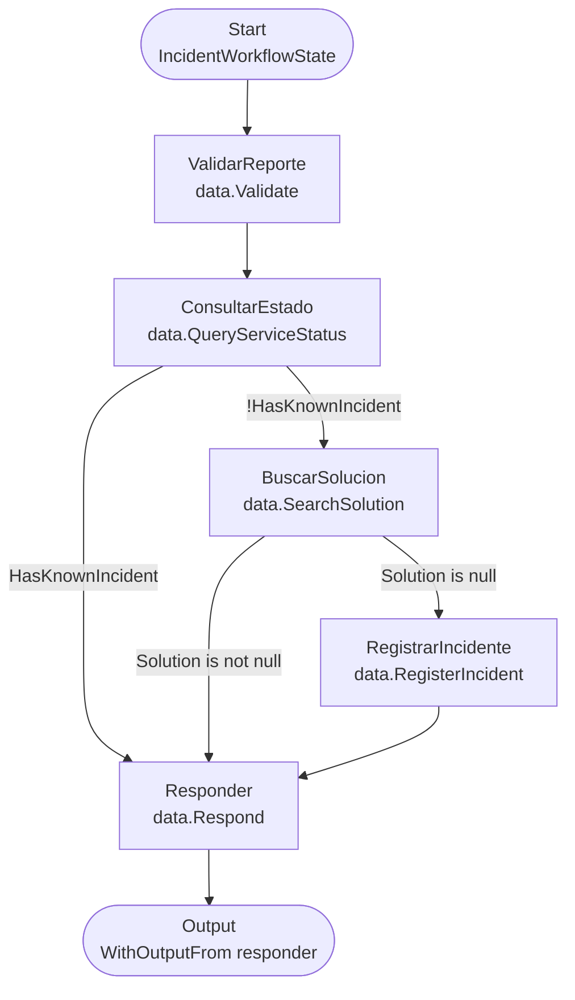
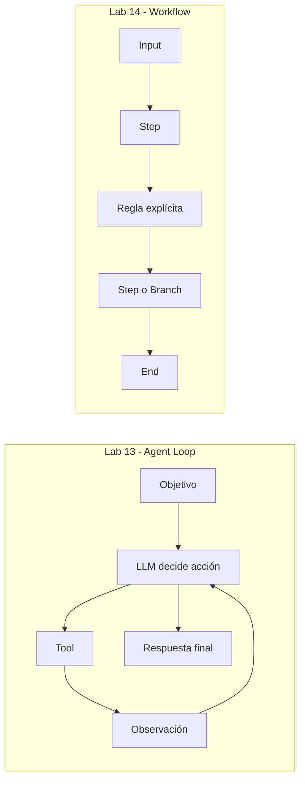

# Lab 14 - Workflows

## Objetivo

Aprender a describir y ejecutar un proceso cuyos pasos y reglas ya conocemos. El laboratorio compara una implementación explícita en C# con el mismo grafo ejecutado mediante Microsoft Agent Framework (MAF).

Este Lab viene después de [Lab 13 - Primer agente](../lab-13-primer-agente/README.md) porque el Agent Loop permite formular la pregunta que guía el ejercicio:

> ¿Todas las decisiones del proceso deberían quedar en manos de un agente?

La respuesta depende del problema. Si el camino se conoce de antemano, la aplicación puede controlar ese camino directamente. Un framework puede ejecutar el workflow, pero no hace falta convertirlo en un agente ni cederle las reglas.

## Relación con Lab 13

Los dos labs usan intencionalmente el dominio conceptual de soporte de incidentes: consultar servicios, revisar soluciones conocidas y registrar casos sin explicación. La repetición permite comparar la orquestación sin cambiar de problema:

| Lab 13 | Lab 14 |
|---|---|
| Agent Loop | Workflow |
| El modelo propone parte de la próxima acción | La aplicación define cada próximo paso |
| La aplicación ejecuta Tools y devuelve observaciones | Los pasos comparten estado y siguen transiciones conocidas |
| El recorrido puede variar entre decisiones | Los casos recorren ramas explícitas y reproducibles |

Los datos de Lab 14 son propios. Compartir el dominio conceptual y datos equivalentes no significa depender de archivos, proyectos o código de Lab 13; cada laboratorio se puede ejecutar y estudiar de forma independiente.

## Qué es un workflow

- **Start:** punto de entrada que recibe el reporte.
- **Step:** operación acotada. Por ejemplo, `ConsultarEstado` busca el servicio y actualiza el estado.
- **State:** `IncidentWorkflowState` conserva el reporte, el estado consultado, la solución, el ID de incidente, la respuesta y los nombres de pasos recorridos. Es el mismo objeto que cada paso recibe y devuelve.
- **Transition:** conexión que indica qué paso puede seguir. Tras `ValidarReporte`, siempre se ejecuta `ConsultarEstado`.
- **Branch:** selección entre transiciones mediante una regla explícita. Después de consultar el servicio se revisa si ya existe una incidencia; después de buscar solución se decide responder o registrar.
- **End:** el paso `Responder` construye la respuesta y se convierte en salida del workflow.

En este laboratorio, las reglas del dominio son deterministas. No hay una llamada a un LLM que decida el branching.

## Qué problema resolvemos

El reporte ya contiene servicio, descripción y, cuando aplica, código de error. Esto mantiene el foco en la orquestación y deja fuera la extracción de datos desde lenguaje natural.



Este es el grafo de **14b**, no sólo una ilustración conceptual: los nombres de los nodos coinciden con los IDs pasados a `BindAsExecutor`, y las flechas con las seis llamadas a `AddEdge` de [`CreateWorkflow`](./lab-14b-workflow-maf/Program.cs). El diagrama y el código se corresponden así:

| Diagrama | Construcción en `CreateWorkflow` |
|---|---|
| Start → `ValidarReporte` | `new WorkflowBuilder(validate)` |
| `ValidarReporte` → `ConsultarEstado` | `.AddEdge(validate, queryStatus)` |
| `ConsultarEstado` → `BuscarSolucion` | `AddEdge` con `!state.HasKnownIncident` |
| `ConsultarEstado` → `Responder` | `AddEdge` con `state.HasKnownIncident` |
| `BuscarSolucion` → `RegistrarIncidente` | `AddEdge` con `state.Solution is null` |
| `BuscarSolucion` → `Responder` | `AddEdge` con `state.Solution is not null` |
| `RegistrarIncidente` → `Responder` | `.AddEdge(registerIncident, respond)` |
| `Responder` → Output | `.WithOutputFrom(respond)` |

Los métodos enlazados a cada nodo están en [`Program.cs`](./lab-14b-workflow-maf/Program.cs); sus operaciones de dominio están en [`IncidentWorkflowDomain.cs`](./Shared/IncidentWorkflowDomain.cs). Sigue las transiciones de arriba hacia abajo y compara las condiciones del dibujo con los `AddEdge` para ver cómo se forma el grafo.

| Caso | Entrada | Decisión y ruta |
|---|---|---|
| A | No puedo usar transferencias | Existe incidencia conocida: responder sin buscar solución ni registrar otro incidente |
| B | Pagos devuelve error 503 | No existe incidencia; hay solución: responder con la recomendación, sin registrar |
| C | Pagos devuelve error X91 | No existe incidencia ni solución: registrar y responder con el ID |

## Agent vs Workflow



Un agente resulta útil cuando la siguiente acción depende de una decisión dinámica hacia un objetivo. Un workflow resulta útil cuando conocemos los pasos, las reglas de transición y las condiciones de término. Un workflow puede contener un paso con un modelo, pero eso no convierte automáticamente el proceso completo en un agente.

## Arquitectura del laboratorio

```text
labs/lab-14-workflows/
├── README.md
├── data/
│   ├── service-status.json
│   └── knowledge-base.json
├── Shared/
│   └── IncidentWorkflowDomain.cs
├── lab-14a-workflow-explicito/
│   ├── Lab14a.WorkflowExplicito.csproj
│   ├── Program.cs
│   └── README.md
├── lab-14b-workflow-maf/
│   ├── Lab14b.WorkflowMaf.csproj
│   ├── Program.cs
│   └── README.md
```

- `data/` contiene el catálogo y conocimiento local propios de Lab 14.
- `Shared/IncidentWorkflowDomain.cs` define los modelos, escenarios, estado y operaciones deterministas comunes. No contiene código de MAF.
- `lab-14a-workflow-explicito/` deja el orden y las condiciones en el programa.
- `lab-14b-workflow-maf/` declara los ejecutores y sus edges condicionales.

## Datos

- `service-status.json` indica que `pagos` está operativo y que `transferencias` está degradado por “Demoras en procesamiento”.
- `knowledge-base.json` incluye respuestas para `503`, `401` y `timeout`; `X91` deliberadamente no tiene solución.

Estos archivos pertenecen a Lab 14 aunque contengan valores equivalentes a los de Lab 13. La repetición es intencional: evita dependencias físicas entre labs y conserva un experimento comparable.

## Lab 14a - Workflow explícito

[Lab 14a](lab-14a-workflow-explicito/README.md) ejecuta cada paso mediante métodos de dominio y usa `if` para elegir la transición. La aplicación organiza el proceso en una secuencia que se puede leer de arriba abajo. No usa un motor de workflows, MAF, agentes ni modelos.

## Lab 14b - Workflow con MAF

[Lab 14b](lab-14b-workflow-maf/README.md) representa las mismas operaciones como ejecutores y transiciones del `WorkflowBuilder`. Los edges condicionales expresan las dos bifurcaciones. MAF ejecuta y enruta el grafo; los predicados y reglas siguen siendo responsabilidad de la aplicación.

## Comparación: 14a vs 14b

| Responsabilidad | 14a | 14b |
|---|---|---|
| Estado y operaciones del caso | Código compartido en `Shared/` | El mismo código compartido |
| Transiciones | Llamadas consecutivas en `Program.cs` | Edges construidos por `AddEdge` |
| Bifurcaciones | Condiciones `if` | Predicados de los edges condicionales |
| Ejecución | Directa en el programa | `InProcessExecution.RunAsync` |
| Quién define las reglas | La aplicación | La aplicación |

La comparación mantiene iguales el input, estado, datos, reglas y resultado. Cambia solamente la estrategia de orquestación.

En 14b los mismos pasos del dominio se enlazan como executors; `WorkflowBuilder` declara el inicio, cada `AddEdge` forma una transición y sus predicados expresan las bifurcaciones. `InProcessExecution.RunAsync` ejecuta el grafo. MAF aporta esa infraestructura, pero la aplicación mantiene las reglas.

El paquete usado es `Microsoft.Agents.AI.Workflows` **1.26.0** para .NET 10. NuGet lista esta versión sin etiqueta prerelease. Consulta la [documentación oficial de workflows](https://learn.microsoft.com/en-us/agent-framework/concepts/workflows/), la guía de [edges](https://learn.microsoft.com/en-us/agent-framework/concepts/workflows/edges) y el [paquete NuGet](https://www.nuget.org/packages/Microsoft.Agents.AI.Workflows/1.26.0).

## Ejecución

Desde la raíz del repositorio, con .NET 10 SDK:

```powershell
dotnet run --project .\labs\lab-14-workflows\lab-14a-workflow-explicito
dotnet run --project .\labs\lab-14-workflows\lab-14b-workflow-maf
```

Las dos aplicaciones son locales y deterministas. No requieren credenciales, proveedor de IA, red ni Docker. La consola muestra los pasos ejecutados y la respuesta para poder comparar los recorridos.

## Resultado esperado

Las rutas impresas por ambas implementaciones deben coincidir:

```text
A: Validar reporte → Consultar estado → Responder
B: Validar reporte → Consultar estado → Buscar solución → Responder
C: Validar reporte → Consultar estado → Buscar solución → Registrar incidente → Responder
```

Para el caso C, la respuesta incluye un ID local como `INC-1001`. El registro sólo vive durante esa ejecución.

## Qué observar en el código

1. En `Shared/IncidentWorkflowDomain.cs`, leer `IncidentWorkflowState` para ver qué datos se transportan.
2. Seguir `Validate`, `QueryServiceStatus`, `SearchSolution`, `RegisterIncident` y `Respond` para separar dominio de orquestación.
3. En el `Program.cs` de 14a, localizar las condiciones que deciden el siguiente paso.
4. En el `Program.cs` de 14b, comparar los IDs de `BindAsExecutor` y las condiciones de `AddEdge` con el diagrama.
5. Ejecutar ambas versiones y comparar las rutas observadas para A, B y C.

## Limitaciones

Este ejercicio no extrae campos desde texto libre, no usa datos persistentes, no se conecta a servicios externos, no evalúa la veracidad de diagnósticos ni incluye agentes. La lista de escenarios está fijada para que las rutas sean reproducibles. La respuesta también está construida localmente: el objetivo es observar el control del proceso, no generar lenguaje con un modelo.

## Qué aprendimos

Al terminar, el alumno debería poder explicar qué representan Start, Step, State, Transition, Branch y End; quién elige el siguiente paso en un Agent Loop y en un Workflow; y qué infraestructura de ejecución delegamos a MAF en 14b sin trasladarle las reglas del dominio.

## Próximo paso

[Lab 15 - Multi-Agent](../lab-15-multi-agent/README.md) estudiará la coordinación entre pocos agentes y cuándo su separación aporta valor. No es una extensión obligatoria de este workflow.

[Roadmap](../../ROADMAP.md) · [Recorrido de labs](../../docs/03-roadmap-labs.md) · [Fundamento pedagógico](../../docs/04-enfoque-pedagogico-y-evolucion-del-roadmap.md)
