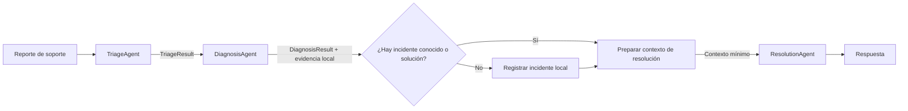

# Lab 15 - Multi-agent

## Objetivo

Observar cuándo aporta valor repartir un caso entre pocos agentes con responsabilidades distintas y comparar dos formas de coordinarlos:

- **15a:** la aplicación coordina explícitamente las llamadas.
- **15b:** Microsoft Agent Framework ejecuta las etapas conectadas como un workflow.

El caso es el diagnóstico de incidentes de soporte. Triage extrae los datos relevantes del reporte; Diagnosis interpreta los datos locales de servicio y conocimiento; Resolution redacta una respuesta para el usuario. Los tres roles generan una salida estructurada y reciben sólo el contexto que necesitan.

## Progresión

```text
Lab 13: un agente decide iterativamente qué hacer
    ↓
Lab 14: un workflow ejecuta pasos y bifurcaciones explícitas
    ↓
Lab 15: varios agentes aportan especialidades distintas
        y una coordinación explícita o delegada
```

Multi-agent no reemplaza al agente individual ni al workflow. Agrega costo de modelo y coordinación; sólo conviene si separar responsabilidades mejora el problema.

## El mismo caso, dos coordinaciones



| Etapa del diagrama | 15a: coordinación explícita | 15b: workflow MAF |
|---|---|---|
| TriageAgent | `RunTriageAgentAsync` | executor `TriageAgent` |
| DiagnosisAgent y consultas locales | `RunDiagnosisAgentAsync` | executor `DiagnosisAgent` |
| Registro protegido por los datos locales | `SupportData.RegisterIncident` | `SupportData.RegisterIncident`, dentro del executor de DiagnosisAgent |
| ResolutionAgent | `RunResolutionAgentAsync` | executor `ResolutionAgent` |
| Coordinación entre etapas | llamadas consecutivas en `Program.cs` | `WorkflowBuilder` y dos `AddEdge` |
| Salida | `ResolutionResult` | salida del executor `ResolutionAgent` |

El registro no es una decisión libre del modelo: sólo se crea cuando no hay incidente conocido ni solución local. Los agentes interpretan y comunican información; la aplicación conserva el control de esa operación con efecto. Las consultas locales también son llamadas de la aplicación, no Tools del modelo: los Labs anteriores ya estudian Tools y aquí el foco es la especialización y la coordinación.

### 15a - Coordinación explícita

```text
Program.cs:
  RunTriageAgentAsync
  → consultar datos locales
  → RunDiagnosisAgentAsync
  → registrar sólo si no hay explicación
  → RunResolutionAgentAsync
```

No usa Microsoft Agent Framework. Las solicitudes al modelo y la coordinación son explícitas en la aplicación, con `Microsoft.Extensions.AI`.

[README de 15a](./lab-15a-multi-agent-explicito/README.md) · [Proyecto](./lab-15a-multi-agent-explicito/Lab15a.MultiAgentExplicito.csproj)

### 15b - Coordinación con Microsoft Agent Framework

```text
WorkflowBuilder(TriageAgent)
  → AddEdge(TriageAgent, DiagnosisAgent)
  → AddEdge(DiagnosisAgent, ResolutionAgent)
  → WithOutputFrom(ResolutionAgent)
```

Cada executor llama a un agente especialista distinto. MAF coordina el grafo; no decide el diagnóstico ni reemplaza los prompts y contratos de cada agente. No usamos `HandoffBuilder`: la secuencia es conocida y el handoff está pensado para transferir control dinámicamente entre agentes.

[README de 15b](./lab-15b-multi-agent-maf/README.md) · [Proyecto](./lab-15b-multi-agent-maf/Lab15b.MultiAgentMaf.csproj)

## Contexto que se transfiere

| Agente | Recibe | Devuelve |
|---|---|---|
| Triage | Reporte del usuario | Servicio, resumen y código de error |
| Diagnosis | Resultado de Triage y observaciones locales | Hallazgo y siguiente paso recomendado |
| Resolution | Reporte, hallazgo, datos relevantes y número de incidente si aplica | Respuesta final |

No se comparte un historial conversacional completo entre agentes. Cada etapa empieza con su propio prompt y un objeto pequeño serializado. Las observaciones de estado y conocimiento son datos ficticios del laboratorio, no una consulta a infraestructura real.

## Escenarios

Ambas implementaciones recorren el mismo conjunto:

1. **Incidente conocido:** transferencias está degradado por demoras; no se duplica el registro.
2. **Solución conocida:** pagos devuelve 503; se informa la recomendación local.
3. **Sin explicación conocida:** pagos devuelve X91; se registra un incidente local.

Los nombres de servicios y códigos forman parte del ejemplo. La respuesta redactada por el modelo puede variar; lo que se compara es el rol de cada agente, el contexto transferido y la política local de registro.

## Ejecución

Se requiere .NET 10, un endpoint compatible con OpenAI que admita structured outputs y las variables de chat habituales en el `.env` de la raíz:

```env
AI_PROVIDER=gemini
AI_MODEL=gemini-3.5-flash-lite
AI_API_KEY=tu-api-key
AI_URL=https://generativelanguage.googleapis.com/v1beta/openai/
```

Desde la raíz del repositorio:

```powershell
dotnet restore .\labs\lab-15-multi-agent\lab-15a-multi-agent-explicito\Lab15a.MultiAgentExplicito.csproj
dotnet run --project .\labs\lab-15-multi-agent\lab-15a-multi-agent-explicito\Lab15a.MultiAgentExplicito.csproj

dotnet restore .\labs\lab-15-multi-agent\lab-15b-multi-agent-maf\Lab15b.MultiAgentMaf.csproj
dotnet run --project .\labs\lab-15-multi-agent\lab-15b-multi-agent-maf\Lab15b.MultiAgentMaf.csproj
```

Cada escenario realiza tres llamadas al modelo. La ejecución requiere conectividad y puede tener latencia o costo. Las dos carpetas son proyectos separados y no dependen de Labs 13 ni 14; comparten únicamente modelos, datos y configuración propios de este Lab.

## APIs y referencias

- [Structured outputs para agentes](https://learn.microsoft.com/en-us/agent-framework/tutorials/agents/structured-output)
- [Workflows en C#](https://learn.microsoft.com/en-us/agent-framework/get-started/workflows)
- [Orquestación Handoff](https://learn.microsoft.com/en-us/agent-framework/workflows/orchestrations/handoff)
- [Microsoft.Agents.AI 1.26.0 en NuGet](https://www.nuget.org/packages/Microsoft.Agents.AI/1.26.0)
- [Microsoft.Agents.AI.Workflows 1.26.0 en NuGet](https://www.nuget.org/packages/Microsoft.Agents.AI.Workflows/1.26.0)
- [Microsoft.Extensions.AI](https://learn.microsoft.com/en-us/dotnet/ai/microsoft-extensions-ai)

## Decidir si Multi-agent aporta

No hace falta cuando una función o un solo agente resuelve el caso sin perder claridad. Cada agente adicional aumenta las llamadas, la latencia, el costo y la posibilidad de inconsistencias. La especialización debe justificar esa coordinación con responsabilidades reconocibles y transferencias de contexto deliberadas.

MCP aparece después para compartir capacidades entre aplicaciones mediante un protocolo estándar; este laboratorio no implementa MCP.

[Roadmap](../../ROADMAP.md) · [Fundamento pedagógico](../../docs/04-enfoque-pedagogico-y-evolucion-del-roadmap.md) · [Siguiente: Lab 16 - MCP](../lab-16-mcp/README.md)
