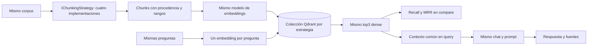

# RAG Semantic Chunking

## Objetivo y pregunta central

**¿Cómo cambia la calidad del retrieval y del RAG según la estrategia utilizada para construir los chunks?**

Esta implementación de referencia compara cuatro estrategias reales sobre **el mismo corpus y el mismo flujo RAG**. No es un Lab ni modifica sus milestones. La variable es cómo segmentamos; Qdrant, modelos, preguntas, topK, contexto y generación permanecen comunes.

## Conocimientos previos

[Prompts](../../labs/lab-04-prompt-templates/README.md), [Structured Output](../../labs/lab-05-structured-output/README.md), [embeddings](../../labs/lab-07-embeddings/README.md), [documentos/chunking](../../labs/lab-08-document-loading/README.md), [RAG](../../labs/lab-09-rag-basico/README.md) y [retrieval/fuentes](../../labs/lab-10-retrieval-calidad/README.md). [rag-vector-store](../rag-vector-store/README.md) introduce Qdrant persistente.

No requiere workflows, agentes, MAF ni MCP. El uso de un LLM para segmentar es una operación concreta controlada por la aplicación.

## Arquitectura



Una consola, composición por constructor, logging y cancelación. `Program.cs` selecciona una implementación de `IChunkingStrategy`; `DocumentIngestionService` mantiene un pipeline común. Qdrant ejecuta búsqueda vectorial real. No se copia Lucene/BM25/RRF del baseline: [Hybrid Search](../rag-hybrid-search/README.md) estudia **cómo buscamos**; aquí estudiamos **qué unidades indexamos**.

## Cuatro estrategias

| Estrategia CLI | Implementación y configuración |
|---|---|
| `fixed` | Ventana máxima 800 UTF-16; preferir párrafo, luego oración, luego corte forzado. Overlap 100 |
| `structure` | Headings/secciones y bloques CommonMark con Markdig; conservar listas/párrafos mientras quepan. Fallback recursivo sin overlap, máximo 800 |
| `semantic` | Bloques iniciales de hasta 400; embedding por unidad y coseno adyacente. Boundary si similitud **<0.72**, respetando mínimo 120 y máximo 800, sin overlap |
| `llm` | Modelo elige un próximo límite entre finales factibles mediante JSON Schema con enum. La aplicación valida y extrae texto original; mínimo 120/máximo 800, sin overlap. Documento máximo 20.000 |

Los parámetros están explícitos en [ChunkingSettings.cs](src/RagSemanticChunking/ChunkingSettings.cs), versionados con el experimento. Un documento completo menor del mínimo semántico se conserva entero. Fixed/structure pueden producir una cola o introducción menor: no se aplica ese mínimo a ambas.

| Estrategia | Usa LLM al segmentar | Embeddings adicionales | Determinista | Costo relativo de segmentación | Usa estructura |
|---|---|---|---|---|---|
| Fixed/Recursive | No | No | Sí | Bajo | Separadores de párrafo/oración |
| Structure-aware | No | No | Sí | Bajo | Headings, bloques y listas explícitos |
| Embedding semantic | No | Sí, uno por unidad | Dado el mismo vector; depende del proveedor | Medio | Bloques iniciales y señal semántica implícita |
| LLM-assisted | Sí, por decisión con varias opciones | No | No | Alto, múltiples llamadas | Unidades Markdown y selección temática |

Todas generan además un embedding por chunk final para indexar. **Fixed no es mala práctica**, y LLM no es automáticamente mejor. Las ventajas dependen del corpus, preguntas, tamaño, costo y tipo documental.

## Corpus y comparación

Cuatro documentos ficticios Aurora: incorporación, seguridad, incidentes y licencias. Tienen secciones, listas, cambios de tema y evidencia distribuida. [queries.json](examples/queries.json) versión 1 define diez preguntas con uno o dos documentos relevantes esperados, sin ChunkIds fijos.

`compare` usa **el mismo vector de cada pregunta** en las cuatro colecciones, topK=3 chunks, coseno y ningún threshold/filtro/reranking. Calcula Recall@3 a nivel documento y MRR sobre el primer chunk relevante. No evalúa automáticamente la exactitud de la respuesta. [Definiciones, métricas y limitaciones](docs/05-comparacion-y-evaluacion.md).

Resultados observados con `gemini-embedding-001` y segmentación LLM con `gemini-3.5-flash-lite`:

| Estrategia | Chunks | Tamaño medio UTF-16 | Recall@3 | MRR |
|---|---:|---:|---:|---:|
| fixed | 20 | 618,3 | 0,95 | 1,00 |
| structure | 20 | 538,3 | 1,00 | 1,00 |
| semantic | 30 | 358,9 | 0,95 | 1,00 |
| llm | 24 | 448,6 | 0,95 | 1,00 |

La diferencia aparece en Q10, que espera licencias e incidentes. Sólo structure recuperó ambos entre tres chunks en esta ejecución. No implica superioridad universal: el corpus es pequeño y Recall por documento no prueba suficiencia de cada fragmento. [Informe completo de validación](docs/09-validacion-observada.md).

## Tecnologías y motivos

Versiones fijadas, estables y compiladas con .NET 10; no hay paquetes preview de Lucene u otros frameworks.

| Paquete | Versión | Responsabilidad y razón |
|---|---|---|
| [Microsoft.Extensions.AI.OpenAI](https://www.nuget.org/packages/Microsoft.Extensions.AI.OpenAI/10.10.1) | 10.10.1 | Adaptadores de chat/embeddings a MEAI; conserva endpoints compatibles y testabilidad |
| [Microsoft.Extensions.VectorData.Abstractions](https://www.nuget.org/packages/Microsoft.Extensions.VectorData.Abstractions/10.10.0) | 10.10.0 | Esquema, upsert y búsqueda común, sin reimplementar infraestructura |
| [CommunityToolkit.VectorData.Qdrant](https://www.nuget.org/packages/CommunityToolkit.VectorData.Qdrant/1.0.0) | 1.0.0 | Provider maduro que traduce VectorData al store real |
| [Qdrant.Client](https://www.nuget.org/packages/Qdrant.Client/1.19.0) | 1.19.0 | Conexión gRPC a Qdrant |
| [Markdig](https://www.nuget.org/packages/Markdig/1.3.2) | 1.3.2 | Parser CommonMark con AST/posiciones; evita un parser Markdown artesanal |
| [DotNetEnv](https://www.nuget.org/packages/DotNetEnv/3.2.0) | 3.2.0 | Reutiliza la carga del `.env` raíz |
| [Microsoft.Extensions.Logging.Console](https://www.nuget.org/packages/Microsoft.Extensions.Logging.Console/10.0.12) | 10.0.12 | Diagnóstico de etapas, errores y esperas de cuota |
| [xunit.v3](https://www.nuget.org/packages/xunit.v3/4.0.2) | 4.0.2 | Tests offline e integración separada |

MEAI Abstractions 10.10.1 y el SDK OpenAI 2.14.0 llegan transitivamente. `ChatResponseFormat.ForJsonSchema(JsonElement, ...)` está disponible en Abstractions: no hace falta agregar el paquete completo de MEAI. `QuotaRetryPolicy` extiende el transporte existente del SDK, sin scheduler propio. El título/URL histórico del [conector](https://learn.microsoft.com/en-us/semantic-kernel/concepts/vector-store-connectors/out-of-the-box-connectors/qdrant-connector) no significa que usemos Semantic Kernel.

## Entorno y configuración

.NET SDK 10, Docker con contenedores Linux y proveedor que soporte embeddings/chat/JSON Schema. [Preparación desde cero, diagnóstico y limpieza](docs/08-entorno-y-ejecucion.md).

Conservar el `.env` raíz:

```env
AI_PROVIDER=openai
AI_MODEL=gpt-4o-mini
AI_EMBEDDING_MODEL=text-embedding-3-small
AI_API_KEY=tu-api-key
AI_URL=
QDRANT_ENDPOINT=http://localhost:6334
```

Ambos modelos, proveedor y clave son requeridos. `AI_MODEL` genera texto y selecciona límites LLM; `AI_EMBEDDING_MODEL` genera vectores. No todos los modelos soportan ambas capacidades. `AI_URL` es alternativo opcional; `QDRANT_ENDPOINT` conserva el default gRPC explícito localhost:6334. No hay variables nuevas ni un segundo `.env` local.

Compose comparte Qdrant v1.19.2 y volumen con referencias anteriores. Los datos se separan en `dac_chunking_fixed`, `dac_chunking_structure`, `dac_chunking_semantic` y `dac_chunking_llm`.

## Ejecutar

```powershell
cd reference/rag-semantic-chunking
docker compose up -d
docker compose ps
curl.exe http://localhost:6333/healthz
dotnet restore
dotnet build
dotnet test
dotnet run --project src/RagSemanticChunking -- ingest --chunking fixed
dotnet run --project src/RagSemanticChunking -- ingest --chunking structure
dotnet run --project src/RagSemanticChunking -- ingest --chunking semantic
dotnet run --project src/RagSemanticChunking -- ingest --chunking llm
dotnet run --project src/RagSemanticChunking -- compare
dotnet run --project src/RagSemanticChunking -- query "¿Qué ticket uso si pierdo el teléfono de MFA?" --chunking llm
```

Cambiar `--chunking` permite consultar cualquiera de las cuatro. `--search-only` evita la generación final. `compare` escribe `artifacts/comparison.md` y `.json`, sin llamar a chat. Los manifiestos guardan boundaries, contenido, modelos y métricas; no guardan claves ni vectores completos. Cambiar proveedor/modelos/corpus/settings exige ingestas comparables según la guía.

La consola muestra etapas, hits, rangos, secciones, respuesta y fuentes. Ante cuota temporal puede esperar al menos un minuto, con hasta dos reintentos SDK y cancelación Ctrl+C. Una propuesta LLM inválida aborta sin fallback; no se contabiliza fixed como éxito LLM.

## Estructura y recorrido

```text
rag-semantic-chunking/
├── README.md, .env.example, docker-compose.yml, global.json
├── RagSemanticChunking.slnx
├── src/RagSemanticChunking/    # consola, estrategias, ingesta, retrieval y evaluación
├── tests/RagSemanticChunking.Tests/              # offline
├── tests/RagSemanticChunking.IntegrationTests/   # Qdrant, fuera de la solución
├── data/                      # cuatro documentos del mismo corpus
├── examples/queries.json       # verdad esperada versión 1
└── docs/                      # arquitectura, decisiones, artefactos y validación
```

Seguí `Program` → estrategia → `DocumentText`/validador → `DocumentIngestionService` → `DocumentRecord`. Para consultas: `VectorSearchService` → `RagContext` → `RagService`. Para medición: `ComparisonService` → `Evaluation`. [Mapa de cada artefacto](docs/00-arquitectura.md).

## Tests y validación

55 unit tests offline y un test separado de integración Qdrant. Este último ejecuta cuatro ingestas/reingestas, metadata, retrieval, comparación y generación inconsistente con IA controlada:

```powershell
dotnet test --project tests/RagSemanticChunking.IntegrationTests
```

Se ejecutaron las cuatro ingestas con proveedor real, comparación de diez queries y RAG completo con la misma pregunta en las cuatro variantes. La validación verifica contenido/cobertura antes de publicar. [Testing](docs/07-testing.md) e [informe observado](docs/09-validacion-observada.md) detallan qué se probó y sus límites.

## Documentación técnica

1. [Arquitectura y artefactos](docs/00-arquitectura.md).
2. [Fixed / Recursive](docs/01-fixed-recursive-chunking.md).
3. [Structure-aware y tipo documental](docs/02-structure-aware-chunking.md).
4. [Embedding semantic](docs/03-embedding-semantic-chunking.md).
5. [LLM-assisted, contrato y validación](docs/04-llm-assisted-chunking.md).
6. [Comparación, Recall y MRR](docs/05-comparacion-y-evaluacion.md).
7. [Modelo de datos, ingesta y RAG](docs/06-modelo-de-datos.md).
8. [Testing y diagnóstico](docs/07-testing.md).
9. [Entorno, ejecución y limpieza](docs/08-entorno-y-ejecucion.md).
10. [Validación observada](docs/09-validacion-observada.md).

Incluyen Mermaid, fuentes oficiales y comentarios/decisiones para seguir el código. Los comentarios C# explican slices, constraints, conservación, publicación y costos, sin repetir cada instrucción.

## Limitaciones y siguientes pasos

No existe un chunk size universal. Se mide por UTF-16, no tokens. Markdown sólo aporta una señal estructural; no se parsea PDF/HTML/Word. El LLM puede variar y agrega varias llamadas/contexto repetido; los límites válidos no garantizan calidad temática. La comparación mide documentos recuperados, no exactitud, groundedness o suficiencia de evidencia. No hay diversidad de fuentes forzada.

La ingesta prepara el corpus en memoria, sin streaming industrial. Qdrant y el manifiesto no comparten transacción; no hay ingestas distribuidas concurrentes. El chequeo de generación se aplica a hits, sin auditoría exhaustiva en cada consulta. Qdrant local sin autenticación es sólo entorno de desarrollo.

La calidad del RAG empieza también en cómo segmentamos y representamos la información que recuperaremos. El próximo reference **planificado** es `reference/rag-advanced-retrieval/`: qué hacer cuando una consulta y un ranking inicial no alcanzan (rewriting, multi-query, reranking). `reference/rag-evaluation/` y `reference/agent-framework/` siguen pendientes. No se crean sus carpetas.

[Índice de reference](../README.md) · [Roadmap](../../ROADMAP.md#implementaciones-de-referencia).
