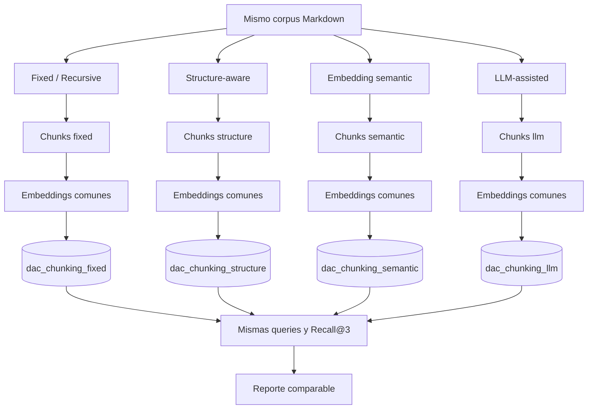

# Arquitectura y recorrido del código

La pregunta es **cómo cambia retrieval al cambiar las unidades indexadas**. Se conservan corpus, queries, embeddings, Qdrant, coseno, topK=3 y generación. Cada estrategia produce sus propios chunks y su propia colección.

Los cuatro cilindros son colecciones del mismo Qdrant. La ingesta tiene un único pipeline. `IChunkingStrategy` está justificada por cuatro implementaciones reales intercambiables. No hay registry, reflection, agentes, workflows ni factories propias.

## Artefactos

Todos los archivos C# están en [src/RagSemanticChunking](../src/RagSemanticChunking/).

| Archivo | Responsabilidad, entradas y salidas |
|---|---|
| [Program.cs](../src/RagSemanticChunking/Program.cs) | CLI y configuración → composición por constructor → comando, presentación y errores. Libera clientes y transmite Ctrl+C |
| [CommandLine.cs](../src/RagSemanticChunking/CommandLine.cs) | Argumentos → comando validado y una de cuatro estrategias |
| [AppConfiguration.cs](../src/RagSemanticChunking/AppConfiguration.cs) | `.env` raíz/entorno → modelos y endpoints validados, siguiendo Hybrid |
| [ChunkingSettings.cs](../src/RagSemanticChunking/ChunkingSettings.cs) | Parámetros explícitos y validación. También contiene topK, versión de esquema y nombres de colección |
| [DocumentText.cs](../src/RagSemanticChunking/DocumentText.cs) | Archivo → texto normalizado, AST Markdig y rangos de unidades. Construye `DocumentChunk` con slices originales |
| [TextPartition.cs](../src/RagSemanticChunking/TextPartition.cs) | Rangos → cortes recursivos y validación de cobertura; evita separar parejas sustitutas Unicode |
| [IChunkingStrategy.cs](../src/RagSemanticChunking/IChunkingStrategy.cs) | Documento → chunks y métricas de trabajo adicional |
| [FixedChunkingStrategy.cs](../src/RagSemanticChunking/FixedChunkingStrategy.cs) | Ventanas máximas, separación recursiva y overlap |
| [StructureAwareChunkingStrategy.cs](../src/RagSemanticChunking/StructureAwareChunkingStrategy.cs) | Headings y bloques Markdown → secciones acotadas |
| [EmbeddingSemanticChunkingStrategy.cs](../src/RagSemanticChunking/EmbeddingSemanticChunkingStrategy.cs) | Unidades + embeddings → similitudes adyacentes → límites bajo threshold/min/max |
| [LlmSemanticChunkingStrategy.cs](../src/RagSemanticChunking/LlmSemanticChunkingStrategy.cs) | Unidades numeradas → propuesta JSON del modelo → validador → chunks |
| [BoundaryProposal.cs](../src/RagSemanticChunking/BoundaryProposal.cs) | Contrato, deserialización estricta y validación determinista del resultado LLM |
| [EmbeddingGeneration.cs](../src/RagSemanticChunking/EmbeddingGeneration.cs) | Textos → embeddings MEAI, validación de cantidad/dimensión y errores HTTP útiles |
| [QuotaRetryPolicy.cs](../src/RagSemanticChunking/QuotaRetryPolicy.cs) | Extiende el transporte del SDK: hasta dos reintentos, espera ante 429, Retry-After y logging, sin repetir validaciones de negocio |
| [DocumentRecord.cs](../src/RagSemanticChunking/DocumentRecord.cs) | Chunk + vector → ID estable, payload y esquema VectorData |
| [IndexManifest.cs](../src/RagSemanticChunking/IndexManifest.cs) | Publicación JSON local: modelos, corpus, generación, IDs, chunks, settings y métricas |
| [DocumentIngestionService.cs](../src/RagSemanticChunking/DocumentIngestionService.cs) | Corpus + estrategia → preparar, validar, generar embeddings, upsert, retirar IDs antiguos y publicar manifiesto |
| [VectorSearchService.cs](../src/RagSemanticChunking/VectorSearchService.cs) | Vector de consulta + manifiesto → top3 real de Qdrant, con generación validada |
| [RagService.cs](../src/RagSemanticChunking/RagService.cs) | Hits → contexto/prompt común → respuesta y fuentes derivadas del contexto |
| [Evaluation.cs](../src/RagSemanticChunking/Evaluation.cs) | Queries + cuatro índices comparables → Recall, MRR y reportes JSON/Markdown; incluye `ComparisonService` |

La inyección por constructor permite reemplazar los clientes de MEAI en tests. El prefijo de colecciones se puede inyectar en ingesta/búsqueda para aislar integración; no es otra variable de entorno ni un mecanismo de plugins.

## Soporte y decisiones

[RagSemanticChunking.slnx](../RagSemanticChunking.slnx) agrupa aplicación y tests offline. [global.json](../global.json) selecciona Microsoft Testing Platform. [docker-compose.yml](../docker-compose.yml) comparte instancia y volumen con los otros references. `.env.example` remite a la configuración raíz. `data/` es corpus; `docs/` nunca se ingesta. `examples/queries.json` versiona la evaluación. `artifacts/` contiene manifiestos y reportes ignorados por Git.

Se reutiliza el patrón maduro de [rag-hybrid-search](../../rag-hybrid-search/README.md), sin copiar Lucene/BM25/RRF: allí cambia **cómo buscamos**; aquí cambia **qué indexamos**. Qdrant resuelve persistencia y ranking. La lógica propia corresponde a segmentación, validación y evaluación del experimento.

Fuentes: [MEAI](https://learn.microsoft.com/en-us/dotnet/ai/microsoft-extensions-ai), [VectorData](https://learn.microsoft.com/en-us/dotnet/ai/vector-stores/overview), [Markdig y AST](https://github.com/xoofx/markdig), [logging .NET](https://learn.microsoft.com/en-us/dotnet/core/extensions/logging).

[README](../README.md) · [Modelo de datos e ingesta](06-modelo-de-datos.md).
