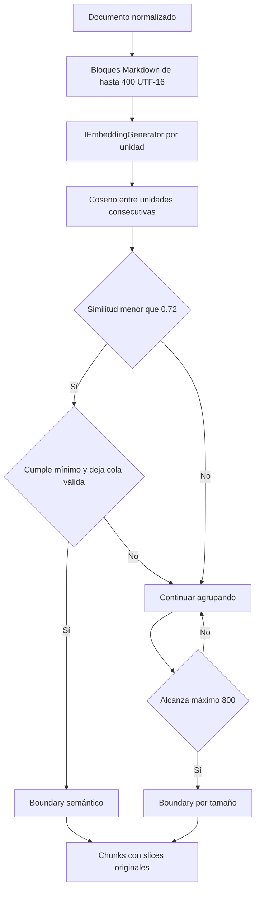

# Embedding-based Semantic Chunking

[EmbeddingSemanticChunkingStrategy](../src/RagSemanticChunking/EmbeddingSemanticChunkingStrategy.cs) observa cambios entre unidades consecutivas mediante embeddings del mismo modelo usado para indexar. La aplicación calcula coseno **sólo para decidir boundaries**; el ranking de consultas sigue delegado a Qdrant.

## Unidad inicial elegida

Usamos **bloques CommonMark**: párrafos, headings, listas o código. Se eligen porque son unidades observables y suelen requerir menos embeddings que segmentar cada oración. Para un bloque mayor de **400 UTF-16**, se usa separación recursiva sin overlap. Los separadores pertenecen a la unidad anterior, de modo que las unidades cubren el texto sin gaps.

Un heading puede ser una unidad corta. No se descarta; el mínimo evita convertir cada cambio alrededor de un título en un chunk diminuto. Esta unidad es más gruesa que una oración: reduce llamadas/entradas, pero puede ocultar cambios internos. Cambiar la unidad o el modelo cambia la sensibilidad y los scores.

## Regla principal y límites

1. Generar un embedding por unidad; conservar orden y comprobar dimensiones.
2. Calcular coseno para cada par adyacente. `Cosine` valida dimensiones, finitud y magnitud no nula.
3. El primer límite con **coseno < 0.72**, tamaño acumulado **>=120** y cola restante **>=120** es candidato aceptado.
4. Si no hay candidato antes de **800**, cortar en el último límite de unidad válido dentro del máximo.
5. Si no existe un límite natural válido, hacer un corte por tamaño que reserve al menos el mínimo para la cola.
6. Continuar hasta el final. Un documento entero menor de 120 conserva su único fragmento.

No se generan overlaps. El máximo es duro; el mínimo puede impedir un corte semántico o requerir un corte mecánico. El threshold es un **parámetro experimental**, no una probabilidad ni una constante transferible a otros modelos. Un valor alto tiende a cortar más; uno bajo tiende a agrupar más hasta el máximo. No hay percentiles ni heurísticas adicionales escondidas.

## Costo, estabilidad y observación

Además de un embedding por chunk final, esta variante genera **uno por unidad inicial**. `AdditionalEmbeddings` cuenta textos vectorizados, no requests HTTP ni tokens facturados. El SDK puede enviar un lote en una llamada; el proveedor define cómo aplica cuotas.

El manifiesto guarda similitudes en orden y motivos de cada chunk. La lógica es determinista dados esos vectores; el proveedor/modelo pueden variar. Los tests usan vectores `[1,0]` y `[0,1]` para demostrar aceptación/rechazo, igualdad con el threshold, mínimo, máximo y cobertura sin red. [SemanticTests](../tests/RagSemanticChunking.Tests/SemanticTests.cs).

Fuentes: [IEmbeddingGenerator](https://learn.microsoft.com/en-us/dotnet/ai/overview/embeddings), [abstracciones MEAI](https://learn.microsoft.com/en-us/dotnet/ai/microsoft-extensions-ai). No se afirma que esta heurística represente todas las técnicas publicadas de semantic chunking.

[README](../README.md) · [LLM-assisted](04-llm-assisted-chunking.md).
