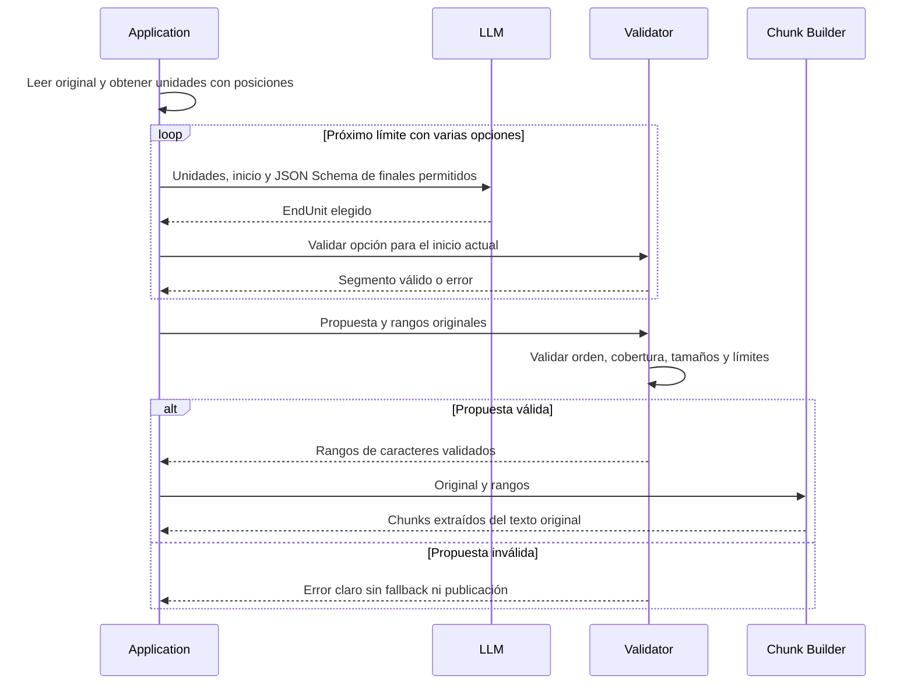

# LLM-assisted: proponer, validar y extraer

[LlmSemanticChunkingStrategy](../src/RagSemanticChunking/LlmSemanticChunkingStrategy.cs) pide al modelo de `AI_MODEL` que agrupe unidades consecutivas por tema. El LLM participa realmente en los boundaries; no genera resúmenes, títulos o texto sustituto. Tampoco es un agente: la aplicación invoca una tarea concreta, sin Tools ni loop autónomo.



## Contrato real

El proveedor debe soportar **Structured Output con JSON Schema** a través del adaptador OpenAI-compatible. Se usa la API compilada de MEAI Abstractions:

```csharp
ChatOptions options = new()
{
    ResponseFormat = ChatResponseFormat.ForJsonSchema(schema, "BoundarySelection"),
    Temperature = 0
};
ChatResponse response = await chat.GetResponseAsync(prompt, options, token);
```

[BoundarySelection](../src/RagSemanticChunking/BoundaryProposal.cs) es el contrato recibido en cada decisión:

```json
{ "EndUnit": 2 }
```

`EndUnit` es exclusivo. La aplicación fija el inicio, calcula los finales factibles y crea un JSON Schema cuyo `enum` admite únicamente esos enteros. El LLM elige el final con mejor cohesión temática. Al avanzar, el inicio siguiente es exactamente el final anterior. Si hay una única opción, no se invoca el modelo.

El esquema dinámico declara `EndUnit` explícitamente, igual que el parser estricto. No se asume coincidencia entre defaults de serialización de MEAI y System.Text.Json. Un test comprueba el enum real enviado. El contrato no contiene texto, títulos o resúmenes.

Las unidades son los mismos bloques acotados a **400 UTF-16** usados por la variante embedding. El prompt incluye índice, longitud y texto; pide cohesión, acompañar títulos con contenido, cubrir todo y respetar **120..800**. Se limita cada documento a **20.000 UTF-16** antes de invocar el modelo: una política conservadora del ejemplo, no una medición del contexto en tokens.

`FeasibleSegments` calcula las alternativas que cumplen tamaños y permiten llegar al final. Cada llamada ofrece sólo finales válidos para el inicio actual, sin delegar aritmética al modelo. La aplicación acumula `BoundarySegment` en una `BoundaryProposal` y valida la partición completa. Si no existe una partición factible, falla antes de invocarlo.

Es una iteración acotada por la cantidad de unidades: cada decisión avanza. No hay objetivos autónomos, selección de herramientas, planner o estado agéntico. El costo es una llamada por límite con varias opciones, en lugar de una única llamada por documento; se registra el número real.

## Validación independiente

`ProposeAsync` obtiene JSON. `BoundaryProposalValidator.Select/Validate` puede probarse sin el modelo:

- JSON estricto, propiedades requeridas y rechazo de campos desconocidos; no se quitan cercos de código ni se adivina texto libre.
- Lista no vacía, segmentos no nulos y rangos de unidades válidos.
- Inicio esperado exacto para cada segmento: detecta gaps, overlaps, duplicados y desorden.
- Fin dentro de unidades, cobertura desde cero hasta la última unidad.
- Tamaños mínimo/máximo; un documento completo menor del mínimo es excepción explícita.
- Validación común de las slices finales: texto exacto, índices, cobertura y ningún overlap.

No se resumen, traducen, insertan o descartan caracteres del documento **normalizado**. La normalización común sólo cambia saltos de línea y recorta extremos; la conservación se define respecto de esa entrada, no de los bytes del archivo.

## Política ante errores

**Sin fallback automático y sin reparación silenciosa.** Una propuesta inválida aborta la ingesta; todos los documentos se preparan antes del primer upsert. Se conserva la publicación anterior si el error ocurre durante esta preparación. El usuario puede revisar modelo/límites y ejecutar nuevamente, o elegir otra estrategia explícitamente. No se contabiliza una ejecución fixed como éxito LLM.

HTTP 400 puede indicar falta de compatibilidad con el esquema; HTTP 429, cuota. `QuotaRetryPolicy` extiende el transporte del SDK con hasta dos reintentos; ante 429 espera al menos 60 segundos y conserva un Retry-After mayor calculado por el SDK. La espera admite cancelación y se informa por logging. No se reintentan propuestas semánticamente inválidas. Un fallo de publicación Qdrant tiene límites distintos: [modelo de datos](06-modelo-de-datos.md).

## Trade-offs

Puede reconocer relaciones implícitas y cambios de tema que no aparecen en un heading. Agrega latencia, consumo económico, dependencia del proveedor, límite de contexto y no determinismo. Temperatura cero no convierte al servicio en una función reproducible. Los manifiestos conservan la segmentación aceptada para inspección; volver a ingerir puede cambiarla.

`LlmCalls` registra invocaciones de aplicación completadas por documento, no intentos HTTP internos ni tokens facturados. No se prometen resultados superiores. Los tests separan contrato y validación de la llamada: [LlmTests](../tests/RagSemanticChunking.Tests/LlmTests.cs).

Fuentes: [ChatResponseFormat.ForJsonSchema](https://learn.microsoft.com/en-us/dotnet/api/microsoft.extensions.ai.chatresponseformat.forjsonschema), [System.Text.Json y propiedades requeridas](https://learn.microsoft.com/en-us/dotnet/standard/serialization/system-text-json/required-properties), [rechazo de campos desconocidos](https://learn.microsoft.com/en-us/dotnet/standard/serialization/system-text-json/missing-members).

[README](../README.md) · [Comparación](05-comparacion-y-evaluacion.md).
