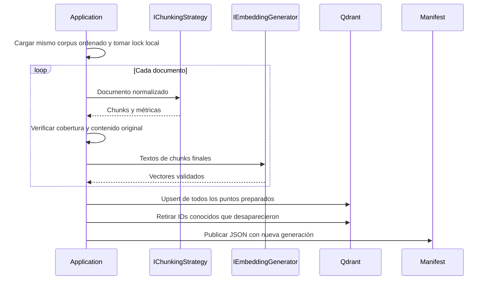

# Modelo de datos, ingesta y RAG

## Del archivo al punto

`DocumentText` conserva fuente, texto normalizado y AST. `TextRange` usa `[Start,End)` en UTF-16. `DocumentChunk` agrega índice, contenido exacto, sección del inicio y motivo de corte. El chunk no contiene embedding; [DocumentRecord](../src/RagSemanticChunking/DocumentRecord.cs) lo agrega al publicar.

| Campo del punto | Para qué sirve |
|---|---|
| `Id` | Key Guid estable derivada de SHA256 de estrategia, fuente e índice |
| `DocumentId`, `Source` | Documento relevante y procedencia visible; coinciden con el nombre en este corpus plano |
| `ChunkIndex`, `ChunkingStrategy` | Posición local desde cero y estrategia que produjo el fragmento |
| `Text` | Slice original normalizada que se recuperará como contexto |
| `Section` | Jerarquía de headings en el inicio, útil para inspección; no es verdad anotada de relevancia |
| `Start`, `End` | Trazabilidad exacta del rango original |
| `BoundaryReason` | Corte por tema, sección, tamaño o final |
| `Generation` | Publicación con la que debe coincidir el manifiesto local |
| `Embedding` | `ReadOnlyMemory<float>` del chunk; dimensión real obtenida del proveedor |

La definición VectorData distingue Key, Data y Vector. Configura coseno y HNSW; Qdrant decide cómo ejecutar la búsqueda. No se implementa un motor vectorial artesanal ni se descargan todos los puntos para ordenarlos en .NET.

## Ingesta común y persistencia

[DocumentIngestionService](../src/RagSemanticChunking/DocumentIngestionService.cs) descubre `.md/.txt` en el nivel superior y ordena por `Ordinal`. El orden facilita reproducibilidad de la ingesta, no define el ranking. Los documentos vacíos son un error del corpus de evaluación.

Todos los documentos, propuestas y embeddings se preparan antes de modificar la colección. Si la preparación falla, no se publica nada. Upsert actualiza posiciones estables y se retiran IDs presentes en el manifiesto anterior que ya no existen. Reingerir no acumula duplicados. No se toca ninguna colección de referencias anteriores.

[IndexManifest](../src/RagSemanticChunking/IndexManifest.cs) guarda esquema, identidad hash de proveedor/endpoint, modelos, dimensión, SHA256 del corpus, settings, generación, IDs, chunks y métricas. Se escribe un temporal y luego se reemplaza el archivo publicado. No guarda claves ni vectores completos.

**No hay transacción entre Qdrant y filesystem.** Una interrupción durante upsert/delete puede dejar publicación parcial. Se detecta generación incompatible en los hits y se exige reingesta, pero no se hace una comparación exhaustiva de todos los puntos en cada query. No ejecutar consultas durante publicación. El lock evita dos escritores desde la misma carpeta, no coordina máquinas distintas. Si existe colección sin manifiesto, se exige recuperar historial o limpiar explícitamente esa colección, evitando dejar huérfanos desconocidos.

## Consulta y respuesta

`VectorSearchService` recibe el vector ya generado y el manifiesto; comprueba dimensión/existencia y usa `SearchAsync` para obtener hasta tres hits. Se conservan scores y metadata nativa. No hay umbral universal: el experimento mide los primeros tres candidatos.

`RagContext.Build` numera los fragmentos y deduplica las fuentes realmente enviadas. `RagService` pide respuesta sólo desde evidencia, con el mismo prompt/temperatura para todas las estrategias. Ante cero hits omite chat. Ante hits irrelevantes corresponde al modelo indicar contexto insuficiente; el prompt no garantiza que lo haga bien. Fuentes derivadas del contexto tampoco prueban que cada frase esté respaldada.

Fuentes: [VectorData](https://learn.microsoft.com/en-us/dotnet/ai/vector-stores/overview), [conector Qdrant](https://learn.microsoft.com/en-us/semantic-kernel/concepts/vector-store-connectors/out-of-the-box-connectors/qdrant-connector), [colecciones Qdrant](https://qdrant.tech/documentation/manage-data/collections/), [puntos y upsert](https://qdrant.tech/documentation/concepts/points/).

[README](../README.md) · [Entorno y limpieza](08-entorno-y-ejecucion.md).
